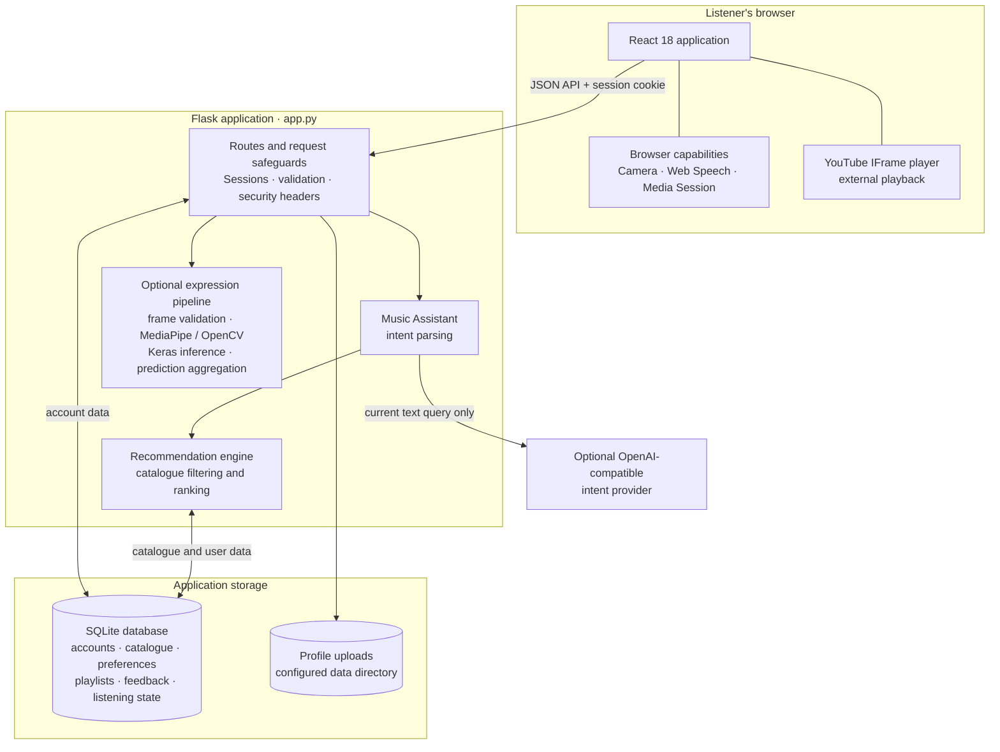
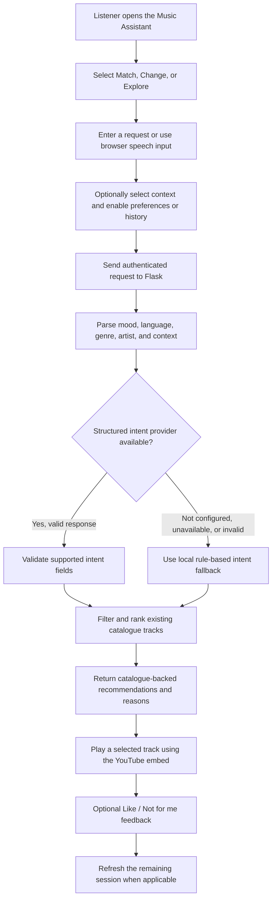

# MannKiDhun

<p align="center">
  <strong>Music discovery for the mood, moment, and languages that make a song feel personal.</strong>
</p>

<p align="center">
  <a href="https://mannkidhun.onrender.com">Live Demo</a> ·
  <a href="https://mannkidhun.onrender.com/community">Community Playlists</a> ·
  <a href="docs/ARCHITECTURE.md">Architecture</a> ·
  <a href="docs/SECURITY.md">Security</a> ·
  <a href="docs/PRODUCT_ROADMAP.md">Roadmap</a>
</p>

<p align="center">
  <a href="https://github.com/naitik2043/MannKiDhun/actions/workflows/ci.yml"></a>
  <a href="LICENSE"></a>
  
  
  
  
</p>

MannKiDhun is an open-source, mood-aware music discovery application built with **React, Vite, Flask, and SQLite**. It helps listeners explore a curated music catalogue through manual mood check-ins, natural-language discovery, optional expression-based suggestions, personal preferences, and social playlists.

The product is designed around one principle: **the listener stays in control**. Manual mood selection always remains available, camera analysis is optional, and recommendations are explainable catalogue matches rather than claims about a person's true emotional state.

---

## Contents

- [Highlights](#highlights)
- [How recommendations work](#how-recommendations-work)
- [Application routes](#application-routes)
- [Technology stack](#technology-stack)
- [Architecture](#architecture)
- [Getting started](#getting-started)
- [Configuration](#configuration)
- [Quality checks](#quality-checks)
- [Privacy and responsible use](#privacy-and-responsible-use)
- [Deployment](#deployment)
- [Known limitations](#known-limitations)
- [Project documentation](#project-documentation)
- [License](#license)

## Highlights

| Area | Capabilities |
| --- | --- |
| Mood discovery | Select a mood manually or optionally request an expression-based suggestion using a short, five-frame check-in. Camera suggestions require user confirmation. |
| Match, Change, Explore | Match a current mood, follow a three-stage Change journey, or explore outside mood filtering. |
| Music Assistant | Search the local catalogue using text or browser speech recognition, including supported Hindi and English (India) inputs. |
| Context-aware discovery | Optionally choose studying, travelling, evening, workout, or sleep. Curated catalogue tags contribute a transparent context-affinity score. |
| Explainable recommendations | Recommendations include catalogue-based reasons. Listeners can respond with Like or Not for me feedback. |
| Adaptive listening sessions | Build Match, Change, or Explore queues and refresh the remaining session using feedback when history-based personalisation is enabled. |
| Global music player | App-level YouTube player with queue persistence, seek, previous / next, repeat, and track-end advancement. |
| Playlists and community | Create playlists, publish selected playlists, browse public collections, and invite collaborators with viewer or editor roles. |
| Group listening | Create six-hour invite-only listening rooms with participant presence and versioned playback-state polling. |
| Personal Music DNA | Opt in to a private summary of recurring languages, genres, artists, listening styles, and vibes. |
| Mood & Music Journal | Add private mood notes and review recent entries. Entries are written by the listener, not inferred from camera data. |
| Personal library | Save tracks, review listening history, and manage music preferences. |
| Regional catalogue | Starter catalogue includes Hindi, English, Punjabi, Bengali, Gujarati, Telugu, Tamil, Malayalam, and Marathi tracks. |

### How recommendations work

MannKiDhun combines catalogue information with optional listener-provided signals. Depending on the selected experience, ranking can consider mood or vibe, declared language and genre preferences, artist affinity, explicit feedback, and optional listening context.

Context matching is a **curated metadata heuristic**: a selected context is compared with catalogue tags such as `calm`, `acoustic`, `driving`, `dance`, and `powerful`. It is not an audio-understanding model and does not access location, calendars, activity sensors, heart rate, or wearable data.

The optional Music Assistant can use local rule-based intent parsing. An OpenAI-compatible structured-intent provider can be configured, but it is not required; when no provider is configured or available, local parsing remains the fallback. The provider receives the current text request for intent extraction, not camera frames, session credentials, or listening history.

## Application routes

| Route | Purpose |
| --- | --- |
| `/` | Product landing page |
| `/signup`, `/signin` | Account creation and authentication |
| `/app`, `/mood-check` | Mood check-in |
| `/assistant` | Music Assistant, discovery controls, sessions, and playlist tools |
| `/dashboard` | Preferences, listening history, Music DNA, journal, and personal music data |
| `/profile` | Account and profile settings |
| `/community` | Public playlist directory |
| `/playlists/<id>` | Read-only public playlist page |

## Technology stack

| Layer | Technologies |
| --- | --- |
| Frontend | React 18, JavaScript, Vite 6, Tailwind CSS |
| Backend | Python 3.11, Flask 3.1, Gunicorn |
| Database | SQLite with configurable storage directory and versioned migrations |
| Expression pipeline | MediaPipe Holistic, OpenCV, Keras, TensorFlow |
| Playback | YouTube IFrame Player API, browser Media Session API where supported |
| Tests | Python `unittest`, Vitest, Testing Library |
| Delivery | Render Blueprint, GitHub Actions, CodeQL |

## Architecture

The application follows a browser-client and Flask API architecture. In production, Flask serves the built React application and handles the API; during development, Vite proxies API requests to the local Flask server.



### How a recommendation request works



The Music Assistant does not invent track names or playback URLs. Recommendations are selected from the catalogue. Listening-history signals are used only when the listener explicitly enables history-based personalisation for the request.

### Detailed diagrams and workflows

See [System architecture](docs/ARCHITECTURE.md) for the component and request-level design, [Application workflows](docs/WORKFLOWS.md) for the product journeys, [Database ER diagram](docs/DATABASE.md#entity-relationship-diagram) for relational data modelling, and [API interaction diagrams](docs/API_INTERACTION.md) for browser-to-backend sequences.

### Important implementation areas

| File or directory | Responsibility |
| --- | --- |
| `app.py` | Flask application, authentication, API endpoints, playlist routes, request safeguards, and health check |
| `recommendation_engine.py` | Catalogue setup, recommendation ranking, feedback, saved tracks, playlists, and listening state |
| `music_assistant.py` | Rule-based intent parsing and optional structured-intent integration |
| `database_migrations.py` | Ordered, versioned SQLite schema migrations |
| `database_ops.py` | Integrity-checked database backup and restore utilities |
| `model_loader.py` | Emotion-model artifact validation and lazy model loading |
| `frame_validation.py` | Input-frame quality and image validation |
| `prediction_aggregation.py` | Multi-frame prediction aggregation and uncertainty handling |
| `frontend/src/` | React UI, application state, player, camera and voice experiences |
| `tests/` | Backend and frontend automated tests |
| `docs/` | Architecture, API, deployment, security, database, catalogue, and product research |

For a deeper component-level explanation, see [Architecture](docs/ARCHITECTURE.md).

## Getting started

### Prerequisites

- Python **3.11**
- Node.js **20.19+** or **22.12+**
- npm
- A modern browser
- `localhost` or HTTPS for browser camera access

### 1. Clone the repository

```bash
git clone https://github.com/naitik2043/MannKiDhun.git
cd MannKiDhun
```

### 2. Create a Python environment and install dependencies

**Windows PowerShell:**

```powershell
$pythonEnv = Join-Path $env:LOCALAPPDATA "mannkidhun-venv"
py -3.11 -m venv $pythonEnv
& "$pythonEnv\Scripts\python.exe" -m pip install --upgrade pip
& "$pythonEnv\Scripts\python.exe" -m pip install -r requirements.txt
npm ci
```

**macOS / Linux:**

```bash
python3.11 -m venv .venv
source .venv/bin/activate
python -m pip install --upgrade pip
pip install -r requirements.txt
npm ci
```

### 3. Start the Flask backend

**Windows PowerShell:**

```powershell
$pythonEnv = Join-Path $env:LOCALAPPDATA "mannkidhun-venv"
& "$pythonEnv\Scripts\python.exe" app.py
```

**macOS / Linux** (with the virtual environment activated):

```bash
python app.py
```

### 4. Start the Vite development server

Open a second terminal at the repository root:

```bash
npm run dev
```

Open the local URL printed by Vite (normally `http://127.0.0.1:5173`). The Vite server proxies `/api` and `/predict` to Flask at `http://127.0.0.1:5001`.

When the frontend origin differs from the Flask host, configure the development origin in the backend environment:

```text
MANNKIDHUN_ALLOWED_ORIGINS=http://localhost:5173,http://127.0.0.1:5173
```

Create an account at `/signup`, then explore mood check-in, Assistant, playlists, and the personal dashboard.

## Configuration

The repository includes [.env.example](.env.example) as a reference. **Flask does not load the `.env` file automatically.** Set variables in your shell or deployment platform.

| Variable | Required | Description |
| --- | --- | --- |
| `MANNKIDHUN_SECRET_KEY` | Production | Stable secret used to sign Flask sessions. Set a strong, private value for every deployed environment. |
| `MANNKIDHUN_COOKIE_SECURE` | Production HTTPS | Set to `1` to enable Secure session cookies when served over HTTPS. |
| `MANNKIDHUN_ALLOWED_ORIGINS` | When needed | Comma-separated browser origins allowed in addition to the request host. Useful for local Vite development. |
| `MANNKIDHUN_DATA_DIR` | Optional | Directory for the SQLite database and profile uploads. Defaults to the repository's `instance/` directory. |
| `AI_ASSISTANT_API_KEY` | Optional | API key for an OpenAI-compatible intent provider. Leave unset to use local intent rules. |
| `AI_ASSISTANT_API_URL` | Optional | HTTPS endpoint for the optional intent provider. |
| `AI_ASSISTANT_MODEL` | Optional | Model identifier sent to the configured provider. |

Do not commit secrets, production credentials, database files, or user uploads.

## Quality checks

Run these checks from the repository root.

### Frontend production build

```bash
npm run build
```

### Frontend tests

```bash
npm test
```

### Backend tests

**Windows PowerShell:**

```powershell
$pythonEnv = Join-Path $env:LOCALAPPDATA "mannkidhun-venv"
& "$pythonEnv\Scripts\python.exe" -m unittest discover -s tests
```

**macOS / Linux** (with the virtual environment activated):

```bash
python -m unittest discover -s tests
```

GitHub Actions runs the frontend build and both test suites for pushes and pull requests. A passing CI workflow validates the configured checks for that commit; it does not independently verify the health of the live Render deployment.

## Privacy and responsible use

- **Camera is optional.** The listener must explicitly start the expression check. Manual mood selection is always available.
- **Temporary frame processing.** The expression check sends five frames for analysis. The endpoint processes them in memory and does not write the frames to disk.
- **No emotional diagnosis.** Expression classes are not calibrated probabilities and do not establish a person's actual feelings. The model has not been established as reliable through a labeled, subject-separated evaluation dataset.
- **Confirmation before use.** An expression estimate must be explicitly confirmed before it can guide a mood-based suggestion; a manual choice can override it.
- **Private journal.** Mood journal entries are manually written and account-scoped.
- **Opt-in personalisation.** Music DNA is disabled until enabled by the listener. Listening-history personalisation is used when the listener enables it for a request.
- **Controlled sharing.** Public playlist publication is opt-in. Public playlists are read-only to visitors; private collaboration uses time-limited viewer or editor invitations.
- **Limited provider data.** When configured, the optional intent provider receives only the current text request, not camera frames, session credentials, or saved listening history.

Facial-expression estimates should not be used to infer a person's actual feelings or for health, employment, educational, or other consequential decisions. See [Security and privacy](docs/SECURITY.md) for implementation safeguards and remaining hardening work.

## Deployment

The repository contains a [Render Blueprint](render.yaml) that installs dependencies, builds the frontend, runs Flask through Gunicorn, and exposes `/healthz` as its health check. The included Blueprint uses Render's **Free** web-service plan and should be treated as a demo deployment.

> **Persistence warning:** the Free Render service has an ephemeral filesystem. Local SQLite data, accounts, playlists, preferences, journal entries, and uploaded profile photos can be lost after restarts or redeploys. Do not use this configuration as durable user-data storage.

For a persistent, single-instance SQLite deployment on Render:

1. Use a paid web-service plan that supports a persistent disk.
2. Attach a disk mounted at `/var/data`.
3. Set `MANNKIDHUN_DATA_DIR=/var/data`.
4. Keep a stable `MANNKIDHUN_SECRET_KEY` and enable secure cookies behind HTTPS.
5. Verify `/healthz`, then test persistence through a controlled restart.
6. Back up the database and rehearse a restore before storing important user data.

The configurable data directory stores both `moodwave.sqlite3` and `profile_uploads/`. SQLite is intended for a single application instance here; larger or multi-instance deployments need a managed database, object storage, shared rate limiting, monitoring, encrypted off-site backups, and tested restore procedures.

See [Deployment and operations](docs/DEPLOYMENT.md) and [Database operations](docs/DATABASE.md).

## Known limitations

- The music catalogue is a curated starter dataset, not a complete licensed streaming catalogue. Playback uses external provider embeds or links; MannKiDhun does not host or sublicense recordings.
- Context matching uses manually curated tags, not a validated audio-feature model for tempo, energy, valence, or era.
- Playback availability, autoplay, and embedding depend on YouTube and browser restrictions. A browser refresh or external navigation interrupts continuous playback.
- Group listening synchronises playlist playback state and recent presence through polling with version checks. It is not WebSocket-based and does not guarantee sample-accurate audio synchronisation.
- Voice features depend on browser speech APIs and are not available in every browser.
- Catalogue coverage varies by language. Assistant language recognition does not imply that a matching track is already in the catalogue.
- Password-reset and verification email delivery are not configured, so normal email-based account recovery is not available.
- Login and assistant rate limits are process-local. They are bounded in memory but are not shared across workers or hosts; distributed rate limiting is required before scaling.
- Browser mutation requests use an origin allowlist and synchronizer-token CSRF checks. Requests omitting both Origin and Referer remain permitted for trusted non-browser / legacy compatibility.
- Scheduled off-site backups, automatic backup retention, and recurring restore drills are not configured.

## Project documentation

| Document | Description |
| --- | --- |
| [Architecture](docs/ARCHITECTURE.md) | Runtime components and key application flows |
| [Application workflows](docs/WORKFLOWS.md) | Mermaid flowcharts for recommendations, mood check-in, playlists, and group listening |
| [API documentation](docs/API_DOCUMENTATION.md) | Backend endpoints and API behaviour |
| [API interaction diagrams](docs/API_INTERACTION.md) | Request lifecycle, authentication, service calls, and API sequence diagrams |
| [Security](docs/SECURITY.md) | Implemented safeguards and production hardening gaps |
| [Deployment](docs/DEPLOYMENT.md) | Render setup, environment configuration, and operations |
| [Database](docs/DATABASE.md) | Schema, migrations, backups, and restore procedures |
| [Database ER diagram](docs/DATABASE.md#entity-relationship-diagram) | Entity relationships, keys, and storage model |
| [Catalogue sources](docs/CATALOGUE_SOURCES.md) | Sources used for curated catalogue entries |
| [Competitive analysis](docs/COMPETITIVE_ANALYSIS.md) | Market context and product differentiation |
| [Upgrade status](docs/UPGRADE_STATUS.md) | Implementation audit and evidence |
| [Product roadmap](docs/PRODUCT_ROADMAP.md) | Shipped capabilities and planned work |

## License

MannKiDhun is distributed under the [MIT License](LICENSE).

Copyright (c) 2026 Naitik Gupta.
