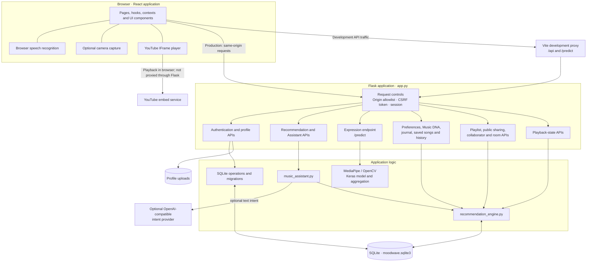
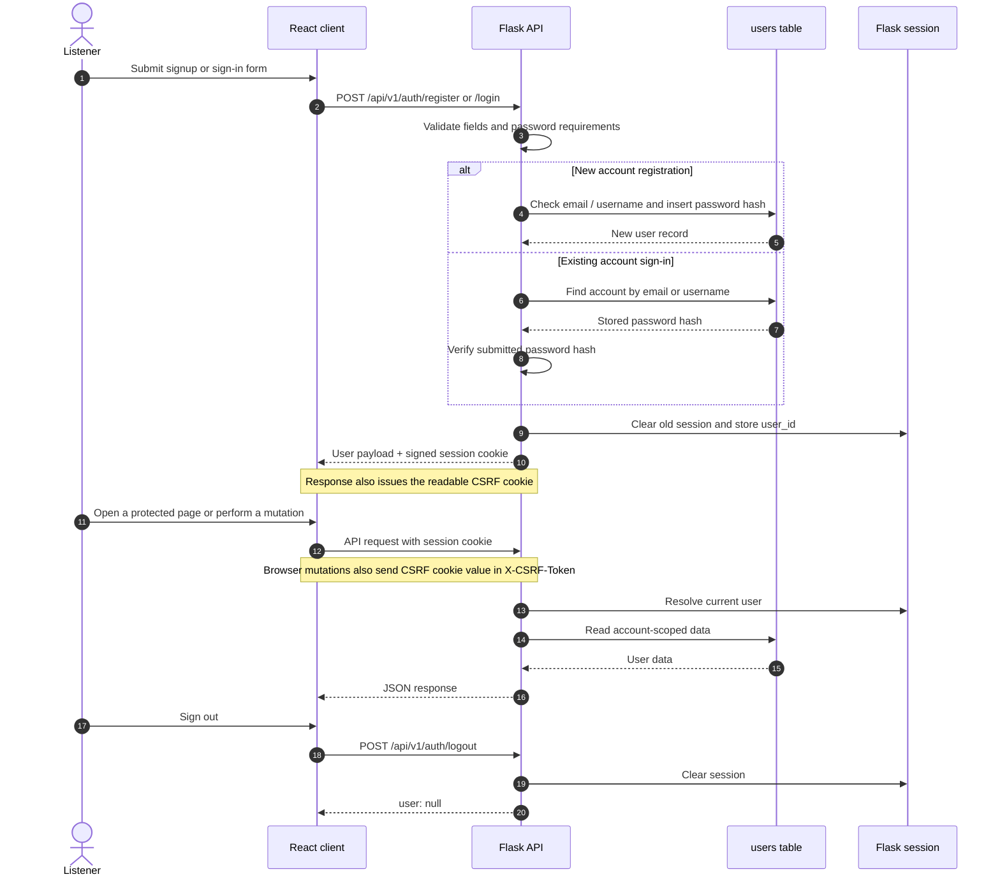
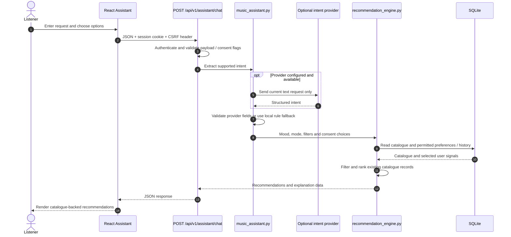
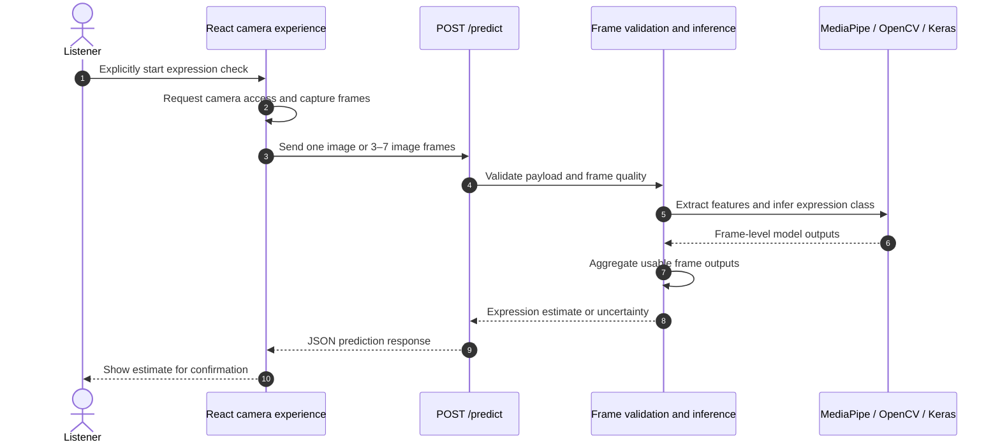

# API interaction diagrams

This document explains how the MannKiDhun browser client communicates with the Flask API and how API requests reach the application services and SQLite database. Endpoint names and flows reflect the current implementation.

## 1. API architecture and routing



### Request path

1. The React client calls the API using same-origin paths. In local development, Vite proxies `/api` and `/predict` to Flask.
2. For browser mutations with an Origin or Referer header, Flask checks the request host against the configured origin allowlist and validates the synchronizer token in the CSRF cookie and `X-CSRF-Token` header.
3. The endpoint applies its authentication and ownership rules. Public playlist reads and selected recommendation reads are available without signing in; personal library and mutation routes are protected.
4. Route handlers call application logic in modules such as `recommendation_engine.py`, `music_assistant.py`, or the expression pipeline.
5. Data operations use SQLite. Profile photos are stored as files in the configured data directory.

Requests that omit both Origin and Referer are permitted for trusted non-browser / legacy compatibility. This compatibility path does not provide browser CSRF protection and should not be treated as a general authentication mechanism.

## 2. Authentication and session lifecycle



The signed Flask session carries the authenticated user ID. Browser mutation requests are protected by origin checks and the synchronizer-token cookie/header flow. Login and Assistant throttling are process-local.

## 3. Music Assistant and recommendation API



Related endpoints:

| Method | Endpoint | Purpose |
| --- | --- | --- |
| GET | `/api/v1/recommendations` | Read catalogue recommendations with optional mood, vibe, and limit filters. |
| POST | `/api/v1/recommendations/generate` | Generate a recommendation set from a JSON request. |
| POST | `/api/v1/assistant/chat` | Authenticated natural-language music discovery. |
| GET | `/api/v1/recommendations/similar/{song_id}` | Find catalogue tracks similar to a selected track. |
| POST | `/api/v1/users/me/adaptive-session` | Build and persist a Match / Change / Explore queue. |
| POST | `/api/v1/users/me/adaptive-session/feedback` | Record Like / Not for me and refresh the remaining queue. |

The optional provider does not create tracks or playback URLs. It receives only the current text request for intent extraction. History-derived ranking signals are included only when the listener explicitly enables them for the request.

## 4. Optional expression endpoint



The current mood-check UI captures five frames. The API endpoint supports a single image or a batch of three to seven frames. The expression endpoint processes images in request memory and does not save the frames to disk. The model output is not a calibrated measure of a person's actual feelings; the listener must confirm any estimate before it is used to prefill Match mode.

## 5. Playlist and collaboration API

```mermaid
sequenceDiagram
    autonumber
    actor Owner
    actor Collaborator
    participant React as Browser client
    participant API as Flask playlist APIs
    participant DB as SQLite

    Owner->>React: Create a playlist
    React->>API: POST /api/v1/playlists
    API->>DB: Insert playlist with owner_id
    DB-->>API: Playlist record
    API-->>React: Created playlist

    Owner->>React: Invite viewer or editor
    React->>API: POST /api/v1/playlists/{id}/invites
    API->>DB: Store SHA-256 token hash, role and expiry
    DB-->>API: Invite record
    API-->>React: Return bearer invite URL once
    Collaborator->>React: Sign in and accept invitation
    React->>API: POST /api/v1/playlists/{id}/invites/accept
    API->>DB: Validate token hash and create collaborator membership
    DB-->>API: Role membership
    API-->>React: Playlist access granted
    Collaborator->>React: Edit tracks when role is editor
    React->>API: POST /tracks or /reorder; DELETE /tracks/{song_id}
    API->>DB: Check role / ownership and persist playlist changes
    DB-->>API: Updated playlist
    API-->>React: Updated playlist response
```

Public playlist reads use `GET /api/v1/public/playlists` and `GET /api/v1/public/playlists/{playlist_id}`. Those public endpoints are read-only. Private collaborators need a valid accepted viewer/editor role.

## 6. Group listening API

```mermaid
sequenceDiagram
    autonumber
    actor Owner
    actor Guest
    participant Browser as Browser clients
    participant API as Flask listening-room APIs
    participant DB as SQLite

    Owner->>Browser: Start a room for an owned playlist
    Browser->>API: POST /api/v1/playlists/{id}/listening-room
    API->>DB: Store room, token hash, expiry and initial state
    DB-->>API: Room created
    API-->>Browser: Bearer invite link and expiry

    Guest->>Browser: Sign in and open invite link
    Browser->>API: POST /api/v1/listening-rooms/{token}/join
    API->>DB: Validate token and record participant
    DB-->>API: Room membership
    API-->>Browser: Room and playlist data

    loop Periodic polling while in room
        Browser->>API: GET /api/v1/listening-rooms/{token}
        API->>DB: Read participant-authorized room state
        DB-->>API: Latest state and presence
        API-->>Browser: Current room state
    end

    Owner->>Browser: Change playback state
    Browser->>API: PUT /api/v1/listening-rooms/{token}/state + expected_version
    API->>DB: Compare version and persist state
    alt Version matches
        DB-->>API: Updated version
        API-->>Browser: 200 with updated room
    else Stale version
        DB-->>API: Conflict
        API-->>Browser: 409; refresh latest state
    end
```

Room links are bearer credentials and must be handled like passwords. Rooms expire after six hours. The current implementation uses periodic polling and optimistic version checks; it does not use WebSockets or guarantee sample-accurate audio synchronisation.

## 7. API endpoint groups

| Area | Key endpoints | Access model |
| --- | --- | --- |
| Authentication | `/api/v1/auth/register`, `/login`, `/me`, `/logout` | Public register/login; session-aware account lookup and logout |
| Account and preferences | `/api/v1/users/me`, `/api/v1/preferences` | Signed-in account |
| Recommendations | `/api/v1/recommendations`, `/generate`, `/similar/{song_id}` | Recommendation reads may be public; verify specific route behaviour in API reference |
| Assistant | `/api/v1/assistant/chat` | Signed-in account |
| Expression estimate | `/predict` | Browser image request; camera action is user-initiated |
| Personal library | `/api/v1/users/me/saved-songs`, `/listening-history`, `/music-dna`, `/mood-journal` | Signed-in account; Music DNA additionally requires opt-in |
| Adaptive sessions and playback | `/api/v1/users/me/adaptive-session`, `/playback-state` | Signed-in account |
| Playlists | `/api/v1/playlists`, `/api/v1/playlists/{id}`, `/tracks` | Owner or permitted collaborator, depending on operation |
| Public playlists | `/api/v1/public/playlists` | Public read-only |
| Collaboration | `/api/v1/playlists/{id}/invites`, `/collaborators` | Playlist owner; invite acceptance requires sign-in |
| Group listening | `/api/v1/playlists/{id}/listening-room`, `/api/v1/listening-rooms/{token}` | Owner creates/closes; signed-in participants join and read/update room state |
| Health | `/healthz` | Unauthenticated service/database health check |

For complete methods, payload examples, and endpoint-specific behaviour, see [API reference](./API_DOCUMENTATION.md).

## 8. Common response statuses

| HTTP status | Typical meaning |
| --- | --- |
| 200 | Successful read or update |
| 201 | Resource created |
| 400 | Invalid request payload or unsupported field |
| 401 | Authentication required or session is not valid |
| 403 | Authenticated user lacks the required permission, or browser-origin / CSRF validation failed |
| 404 | Resource not found, expired invitation, or inaccessible resource |
| 409 | Resource conflict, such as a stale group-room playback version |
| 413 | Uploaded image exceeds the request size limit |
| 429 | Login or Assistant request rate limit reached |
| 503 | Health check cannot access the SQLite database |

