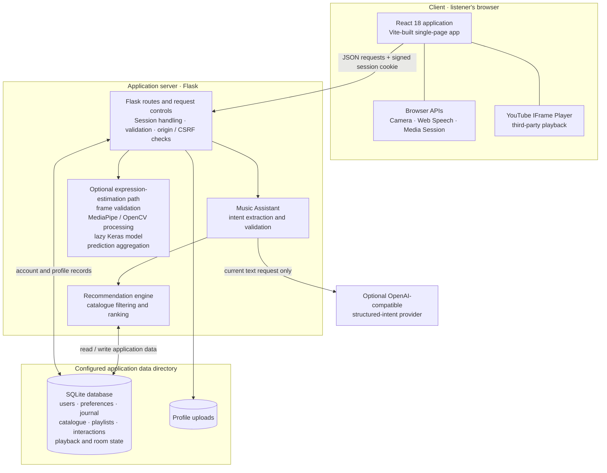
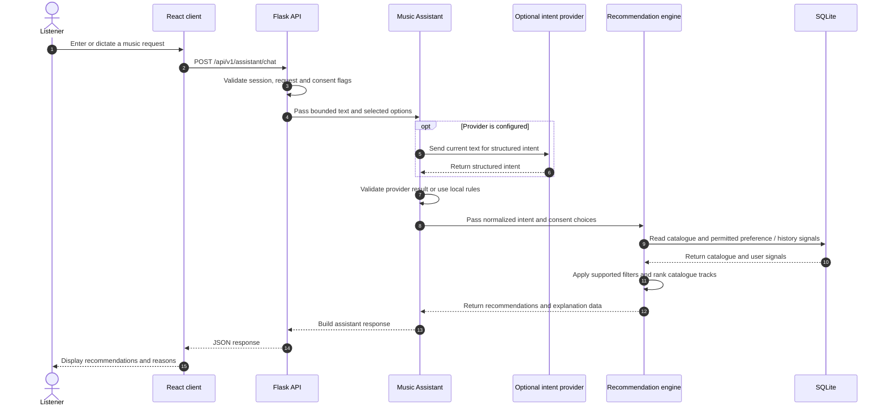
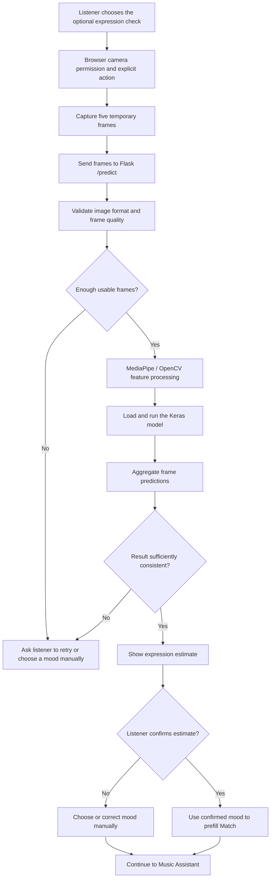

# System architecture

This document describes the current MannKiDhun implementation: a React browser application, a Flask application server, a SQLite persistence layer, and optional browser / provider integrations.

## 1. System overview

### Runtime and deployment

- **Production:** the React application is built into `frontend/dist`; Flask serves the built frontend and handles API requests in the same application service.
- **Development:** Vite serves the frontend and proxies `/api` and `/predict` requests to Flask.
- **Persistence:** SQLite and profile uploads are stored beneath `MANNKIDHUN_DATA_DIR`, defaulting to the repository's `instance/` directory.
- **Playback:** the YouTube IFrame player runs in the browser. Playback availability, autoplay, and embedding are controlled partly by YouTube and browser policies.
- **Optional integrations:** the structured-intent provider is not required. Local rule-based parsing is the fallback.

## 2. Assistant request lifecycle

The authenticated Assistant request includes a bounded message, the selected mode, optional previous intent, optional context, and explicit preference / history consent flags.

### Intent parsing and ranking

1. The client submits a text request and the user's selected options.
2. The Assistant extracts supported intent such as mood, genre, language, artist, and listening context.
3. When configured, the optional provider can return structured intent. The backend validates those values against supported fields and catalogue artists.
4. If the provider is absent, unavailable, or returns unusable data, local rule-based parsing is used.
5. The recommendation engine filters and ranks existing catalogue records using the request, catalogue metadata, declared preferences, artist affinity, explicit feedback, and optional context-tag affinity.
6. The API returns catalogue-backed recommendations and explanation text. The assistant provider does not generate track names or playback URLs.

### Personalisation boundaries

- Preference and history signals are separately controlled by request consent flags.
- Music DNA is disabled until the listener opts in.
- Assistant conversation messages remain in page memory; they are not persisted as chat transcripts.
- The optional intent provider receives the current text request only. It does not receive camera frames, session credentials, or saved listening history.
- Context matching uses curated catalogue tags. It does not infer context from location, calendars, activity sensors, heart rate, or wearable data.

## 3. Optional expression-estimation path

Expression-based mood suggestions are an optional input path, not a required step in music discovery.

The five frames are processed in request memory and are not written to disk by the expression endpoint. Model class scores are not calibrated probabilities and do not establish a person's actual emotional state. A manual mood choice remains available and can replace the estimate.

## 4. Playback, feedback, and adaptive sessions

The recommendation engine returns catalogue records. The browser plays selected tracks through the YouTube IFrame Player API.

- Starting a catalogue track can record a `play` interaction.
- The listener can provide `like` or `skip` feedback.
- Positive and negative interaction signals can influence history-aware ranking only when the listener enables history use for the relevant request.
- Adaptive sessions save a queue snapshot as playback state. Feedback can re-rank the remaining queue and save the updated queue.
- The app-level player persists its queue locally across internal navigation. It cannot guarantee continuous playback through browser refreshes, external navigation, provider restrictions, or unsupported browser behaviour.

## 5. Playlists and group listening

- Playlist owners can keep a playlist private or publish it to the Community directory. Public playlist pages are read-only.
- Owners can issue seven-day viewer or editor invitation links. Editors can add, remove, and reorder tracks; viewers can read but not edit. Owners retain role and access-management controls.
- Playlist owners can create six-hour group listening rooms. Signed-in guests join with a bearer link. Participants exchange playlist-scoped playback state and recent presence through polling.
- Playback-state writes use monotonically increasing versions / optimistic checks. A stale update can return HTTP 409 and must be refreshed before retrying.
- Group rooms use periodic polling, not WebSockets, and do not provide sample-accurate audio synchronisation.

## 6. Persistence and data boundaries

| Data | Storage / handling |
| --- | --- |
| Accounts, password hashes, preferences, journal entries | SQLite |
| Music catalogue, playlists, saved tracks, listening interactions | SQLite |
| Playback queue and room state | SQLite-backed application state |
| Profile images | Files under the configured data directory |
| Assistant conversation | Browser page memory; not stored as a conversation transcript |
| Expression-check frames | Request memory during inference; not written to disk by the expression endpoint |
| YouTube playback | Third-party embed in the listener's browser |

The application uses versioned SQLite migrations and includes integrity-checked manual backup / restore utilities. Backups are not automatically scheduled by the application.

## 7. Security controls and operational limits

The current application includes:

- Signed Flask sessions with HttpOnly and SameSite=Lax session cookies.
- Browser mutation checks using configured origin rules and a synchronizer-token CSRF cookie/header.
- Security response headers, input validation, parameterised SQL, and account-scoped data access.
- Failed-login throttling and Assistant rate limits held in bounded, process-local memory.

Important deployment boundaries:

- Requests omitting both Origin and Referer remain allowed for trusted non-browser / legacy compatibility; browser-origin enforcement is not a general API authentication substitute.
- Login and Assistant limits are not shared across workers or hosts. A shared rate-limit store is needed before horizontal scaling.
- The included Render Free Blueprint uses ephemeral storage. Local SQLite data and uploaded profile images can be lost on restart or redeploy.
- A persistent Render disk with SQLite is intended for a single application instance. Multi-instance production use requires a managed database, object storage, shared rate limiting, backups, monitoring, and additional operational hardening.

See [Security](./SECURITY.md), [Deployment](./DEPLOYMENT.md), [Database](./DATABASE.md), and [API documentation](./API_DOCUMENTATION.md) for implementation details.
