# Database

The application uses a single SQLite file at `<MANNKIDHUN_DATA_DIR>/moodwave.sqlite3`. If `MANNKIDHUN_DATA_DIR` is unset, the default is `instance/moodwave.sqlite3` under the repository root. The same data directory contains the `profile_uploads/` directory. The directory is created by the application and is ignored by Git. Back up the database before updating or running the application.

## Main tables

- `users`: account identity, password hash, verification/onboarding flags, and an optional profile-photo URL. Profile photos are normalized to JPEG and stored under the configured data directory's `profile_uploads/` directory; the database stores only the photo URL.
- `user_preferences`: one row per user; JSON-encoded language, genre, listening-style, and artist lists plus the opt-in `music_dna_enabled` flag.
- `mood_journal_entries`: private, manually entered mood labels and optional notes, account-scoped with cascade deletion.
- `password_reset_tokens`: hashed one-time tokens with type, expiry, and use time. Email delivery is not implemented, so account recovery is not currently operational.
- `artists`, `genres`, `songs`, `song_genres`, `song_tags`: local recommendation catalogue and provider metadata.
- `user_song_interactions`, `saved_songs`, `recommendation_events`: user activity and library state.
- `playlists`, `playlist_tracks`: user-owned playlists and ordered catalogue entries.
- `playlist_collaborators`: user membership with viewer/editor role, unique per playlist/user.
- `playlist_invites`: hashed bearer invitation tokens with role, expiry, and revocation timestamps; raw tokens are returned only at creation time.
- `playback_states`: one current playback / queue snapshot per user. The global player writes the current track, elapsed position, queue IDs, and repeat mode.
- `listening_rooms`, `listening_room_participants`: six-hour invite-only group rooms, hashed bearer tokens, shared playlist state, optimistic version, and recent participant presence.
- `schema_migrations`: ordered migration versions and timestamps; migration 1 creates the group listening room tables.

Account-owned data references `users` with `ON DELETE CASCADE`. Track and playlist relations also declare foreign keys. Every application SQLite connection enables foreign-key enforcement. `database_migrations.py` applies ordered, idempotent migrations at startup and records each applied version in `schema_migrations`; migration 1 creates group-room tables. Migrations do not yet provide rollback, so make a backup before applying schema changes.

The current SQLite-oriented implementation is not verified for PostgreSQL. Do not point `DATABASE_URL` at PostgreSQL; the active app uses `AUTH_DATABASE` and SQLite paths. A mounted Render disk can provide persistence for a single service instance, but it does not replace a managed database or make multi-instance SQLite safe.

## Entity Relationship Diagram

The diagram below models the principal relational tables created by `app.py`, `recommendation_engine.py`, and `database_migrations.py`. It shows declared foreign-key relationships; JSON arrays and IDs stored inside text columns are not relational foreign keys.

```mermaid
erDiagram
    USERS ||--o| USER_PREFERENCES : has
    USERS ||--o{ PASSWORD_RESET_TOKENS : owns
    USERS ||--o{ MOOD_JOURNAL_ENTRIES : writes
    USERS ||--o{ USER_FAVOURITE_ARTISTS : selects
    ARTISTS ||--o{ USER_FAVOURITE_ARTISTS : favourited_by

    ARTISTS ||--o{ SONGS : credited_on
    SONGS ||--o{ SONG_GENRES : classified_by
    GENRES ||--o{ SONG_GENRES : assigned_to
    SONGS ||--o{ SONG_TAGS : labelled_with

    USERS ||--o{ USER_SONG_INTERACTIONS : creates
    SONGS ||--o{ USER_SONG_INTERACTIONS : receives
    USERS ||--o{ RECOMMENDATION_EVENTS : has
    SONGS ||--o{ RECOMMENDATION_EVENTS : appears_in
    USERS ||--o{ SAVED_SONGS : saves
    SONGS ||--o{ SAVED_SONGS : saved_by

    USERS ||--o{ PLAYLISTS : owns
    PLAYLISTS ||--o{ PLAYLIST_TRACKS : contains
    SONGS ||--o{ PLAYLIST_TRACKS : included_in
    USERS ||--o{ PLAYLIST_COLLABORATORS : joins
    PLAYLISTS ||--o{ PLAYLIST_COLLABORATORS : shared_with
    USERS ||--o{ PLAYLIST_INVITES : creates
    PLAYLISTS ||--o{ PLAYLIST_INVITES : has

    USERS ||--o| PLAYBACK_STATES : has
    USERS ||--o{ LISTENING_ROOMS : owns
    PLAYLISTS ||--o{ LISTENING_ROOMS : hosts
    LISTENING_ROOMS ||--o{ LISTENING_ROOM_PARTICIPANTS : includes
    USERS ||--o{ LISTENING_ROOM_PARTICIPANTS : joins

    USERS {
        int id PK
        string name
        string full_name
        string username
        string email UK
        string password_hash
        string profile_image
        boolean is_email_verified
        boolean onboarding_completed
    }
    USER_PREFERENCES {
        int id PK
        int user_id FK,UK
        text preferred_languages
        text preferred_genres
        text preferred_listening_styles
        text favourite_artists
        boolean music_dna_enabled
    }
    PASSWORD_RESET_TOKENS {
        int id PK
        int user_id FK
        string token_type
        string token_hash
        datetime expires_at
        datetime used_at
    }
    MOOD_JOURNAL_ENTRIES {
        int id PK
        int user_id FK
        string mood
        text note
        datetime created_at
    }
    ARTISTS {
        int id PK
        string name UK
        string normalized_name UK
        string external_provider_id
    }
    GENRES {
        int id PK
        string name UK
        string normalized_name UK
    }
    SONGS {
        int id PK
        string title
        int artist_id FK
        string album
        string language
        string genre
        int duration
        string provider
        string provider_track_id
        string provider_url
    }
    SONG_GENRES {
        int id PK
        int song_id FK
        int genre_id FK
    }
    SONG_TAGS {
        int id PK
        int song_id FK
        string tag
    }
    USER_FAVOURITE_ARTISTS {
        int id PK
        int user_id FK
        int artist_id FK
    }
    USER_SONG_INTERACTIONS {
        int id PK
        int user_id FK
        int song_id FK
        string interaction_type
        string source
        int position_ms
        int duration_ms
    }
    RECOMMENDATION_EVENTS {
        int id PK
        int user_id FK
        int song_id FK
        string recommendation_source
        float ranking_score
    }
    SAVED_SONGS {
        int id PK
        int user_id FK
        int song_id FK
        datetime created_at
    }
    PLAYLISTS {
        int id PK
        int user_id FK
        string name
        boolean is_public
    }
    PLAYLIST_TRACKS {
        int id PK
        int playlist_id FK
        int song_id FK
        int position
    }
    PLAYLIST_COLLABORATORS {
        int playlist_id FK
        int user_id FK
        string role
    }
    PLAYLIST_INVITES {
        int id PK
        int playlist_id FK
        int created_by FK
        string token_hash UK
        string role
        datetime expires_at
        datetime revoked_at
    }
    PLAYBACK_STATES {
        int id PK
        int user_id FK,UK
        int current_song_id
        int position_ms
        text queue
        boolean shuffle
        string repeat_mode
    }
    LISTENING_ROOMS {
        int id PK
        int playlist_id FK
        int owner_id FK
        string token_hash UK
        text state_json
        int version
        datetime expires_at
    }
    LISTENING_ROOM_PARTICIPANTS {
        int room_id PK,FK
        int user_id PK,FK
        datetime joined_at
        datetime last_seen
    }
```



### Relationship and modelling notes

| Relationship | Meaning |
| --- | --- |
| User → Preferences | One preferences row per user; `user_preferences.user_id` is unique. |
| Artist → Songs | Each song references one artist; an artist can be associated with multiple songs. |
| Songs ↔ Genres | Many-to-many through `song_genres`. The song record also retains a text `genre` field for catalogue metadata. |
| Users ↔ Artists | Favourite-artist records are stored in `user_favourite_artists`; preference lists also retain JSON-encoded values in `user_preferences`. |
| Users ↔ Songs | Interactions, saved songs, and recommendation events are separate account-scoped records. |
| Playlists ↔ Songs | Ordered many-to-many relationship through `playlist_tracks`. A playlist/song pair is unique. |
| Users ↔ Playlists | Owners are recorded on `playlists.user_id`; collaborator access is held separately in `playlist_collaborators`. |
| Playlist invitations | `playlist_invites` stores a hash of the bearer token, assigned role, creator, expiry, and revocation time. |
| Playback state | One row per user. `current_song_id` and the queue IDs are stored values, not declared foreign keys. |
| Group listening | A room belongs to one playlist and one owner; participants are linked through `listening_room_participants`. |

**Implementation details:** `playlist_collaborators` has a unique constraint on (`playlist_id`, `user_id`) rather than a separate surrogate ID. `playlist_tracks`, `saved_songs`, `user_favourite_artists`, `song_genres`, and `user_song_interactions` also enforce their documented unique combinations. `schema_migrations` is a schema-management table and is intentionally not connected to user or catalogue records.

## Backup, verification, and restore

The repository includes `database_ops.py`, which uses SQLite's online backup API and verifies database integrity plus foreign-key consistency.

From the repository root:

```powershell
# Verify the active database.
python database_ops.py verify

# Create and verify a consistent online backup.
python database_ops.py backup --output backups\moodwave-backup.sqlite3

# Restore a verified backup. --overwrite first preserves the current DB
# in a timestamped .pre-restore safety copy.
python database_ops.py restore --source backups\moodwave-backup.sqlite3 --overwrite
```

Pass `--database <path>` to manage a non-default database. The default path follows `MANNKIDHUN_DATA_DIR` or `instance/moodwave.sqlite3`. Stop application writers before restoring. These are manual utilities; they do not schedule off-site backups, encrypt backup files, or replace a regular restore drill.
