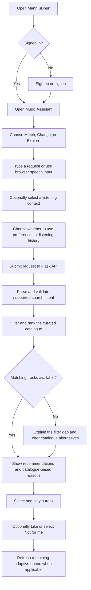
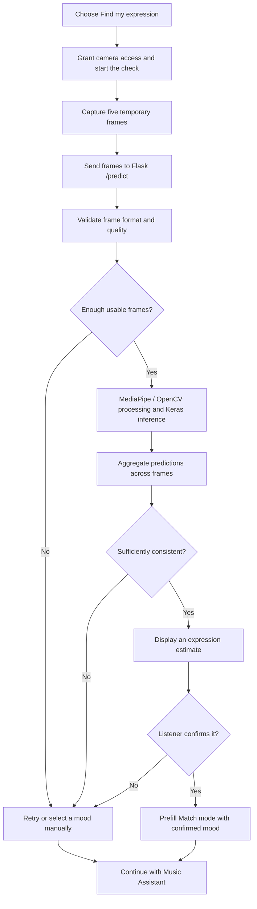
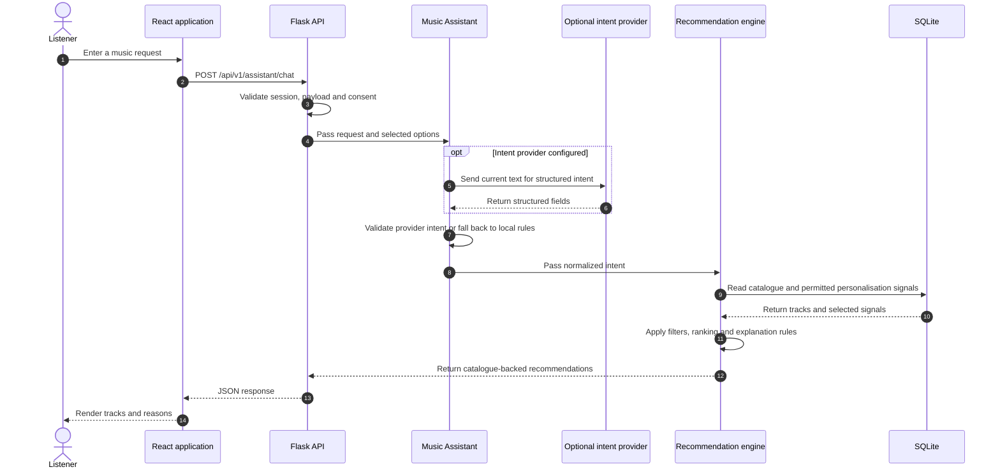
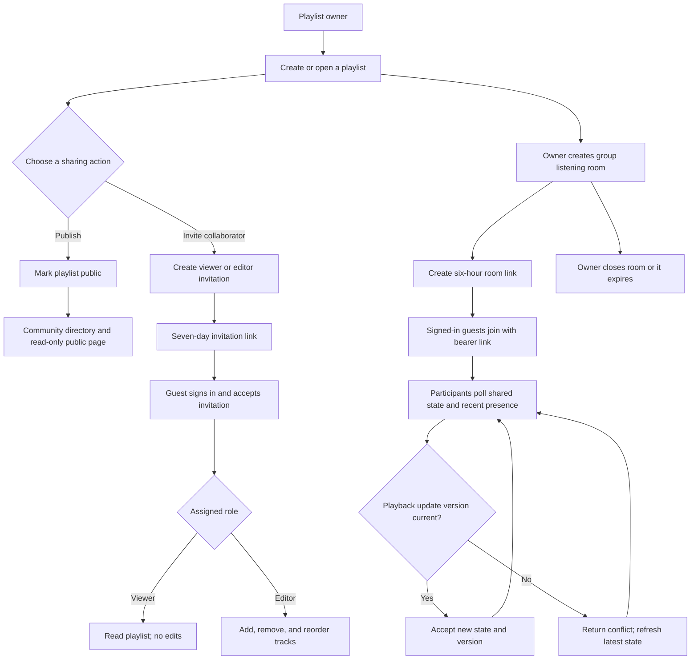
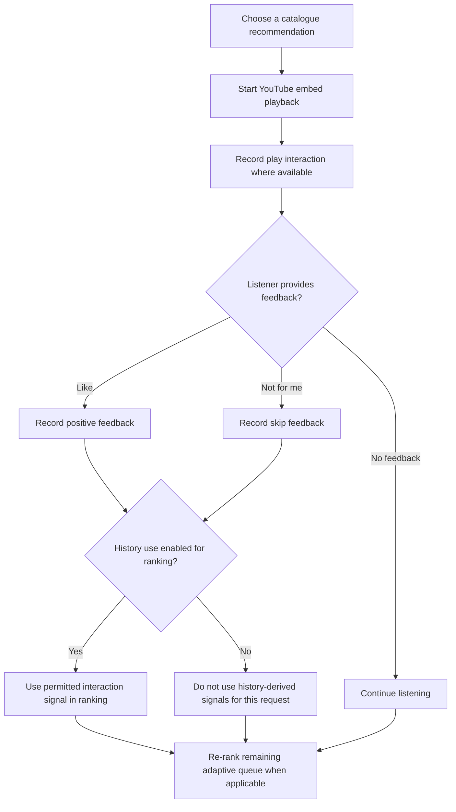

# Application workflows

This document explains the main listener and collaboration journeys in MannKiDhun. The diagrams describe the current implementation and its boundaries, rather than future roadmap concepts.

## 1. Music discovery journey

### Modes

- **Match:** find catalogue tracks for the current or requested mood.
- **Change:** create a three-stage source mood → heuristic bridge → target mood journey.
- **Explore:** browse without a mood constraint while retaining explicit catalogue filters.

Change is a catalogue-ranking heuristic. It is not a validated psychological model.

## 2. Optional expression-based check-in

**Privacy boundary:** camera use is optional. Five frames are processed in request memory and are not written to disk by the expression endpoint. A model estimate is not a reliable measurement of inner emotional state; the listener must confirm it, and manual selection remains available.

## 3. Assistant request sequence

The optional provider does not receive camera frames, session credentials, or listening history. If it is not configured or cannot produce usable structured intent, local rule-based parsing is used.

## 4. Playlist collaboration and group listening

Playlist editing access and group listening rooms are separate features. Collaboration invitations control who can access or edit a playlist; a listening-room invitation controls participation in a temporary shared playback session.

### Collaboration rules

- Public playlists are opt-in and read-only to visitors.
- Private playlist invitations expire after seven days and grant either viewer or editor access.
- Accepted collaborators are managed by the playlist owner; revoking an unused invite does not automatically remove an already accepted collaborator.
- Group listening rooms expire after six hours. Treat the room URL as a bearer secret.
- Guests must be signed in to join a room. Room state is synchronised through periodic polling and optimistic version checks, not WebSockets.

## 5. Playback and feedback lifecycle

Feedback is stored against the signed-in account. History-derived recommendation signals are used only when the listener explicitly enables history use for the request. The global queue is application-managed; audio delivery remains subject to YouTube and browser restrictions.
